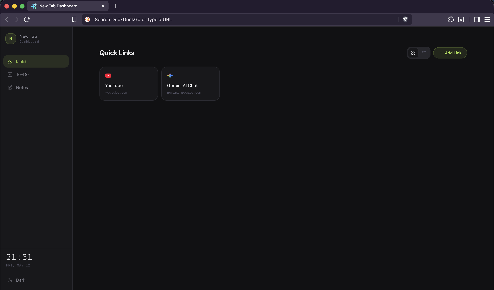
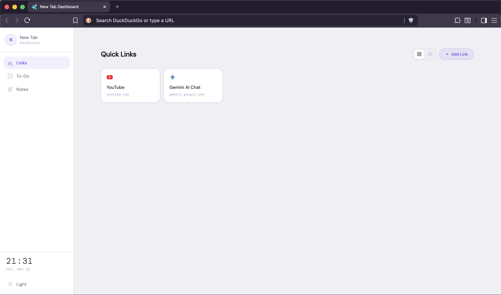

# New Tab Dashboard

A lightweight, distraction-free Chrome extension that transforms your default "New Tab" page into a sleek, personal productivity hub. Designed to help you stay organized, focused, and efficient every time you open a new tab.

## Screenshots

<table align="center">
    <tr>
        <td align="center">
            
        </td>
        <td align="center">
            
        </td>
    </tr>
    <tr>
        <td>Dark Mode</td>
        <td>Light Mode</td>
    </tr>
</table>

## Features

*   **Link Saver:** Bookmark and organize your favorite or frequently visited websites for quick access.
*   **Quick Notes:** Jot down ideas, thoughts, or scratchpad text instantly without leaving your tab.
*   **To-Do List:** Manage daily tasks, track progress, and check off items to stay on top of your workflow.
*   **Clean UI:** Minimalist and modern design crafted to reduce clutter and cognitive overload.

## Built With

*   HTML5
*   CSS3
*   TypeScript
*   Vite+ (Vite 8 + Rolldown)
*   Bun (managed by Vite+)
*   Chrome Extension APIs (`storage` for saving data locally)

## Toolchain (Vite+)

Install the [Vite+](https://viteplus.dev) CLI:
```bash
curl -fsSL https://vite.plus | bash
```

The project uses Vite+ 1.3 through the local `vite-plus` dev dependency. `vp` runs the package scripts and installs dependencies with the pinned Bun version (`"packageManager": "bun@1.3.14"`), so no separate Bun, Vite, or linter install is needed. Vite 8, Rolldown, and Oxlint all come from the toolchain.

| Command | Runs |
| --- | --- |
| `vp install` | Install dependencies through the pinned Bun version |
| `vp run dev` | The `dev` script (`vp dev`) — Vite dev server |
| `vp run build` | The `build` script (`tsc --noEmit && vp build`) — type check, then bundle to `dist/` |
| `vp run preview` | The `preview` script (`vp preview`) |
| `vp run typecheck` | The `typecheck` script (`tsc --noEmit`) |
| `vp run lint` | The `lint` script (`vp lint`) — Oxlint |

`vp run <script>` executes the matching `package.json` script; the toolchain commands (`vp dev`, `vp build`, `vp lint`) can also be run directly.

`vite` stays in `package.json` as an alias to `@voidzero-dev/vite-plus-core` (see `overrides`), so plugins that import `vite` share the same instance as the toolchain. Do not add a standalone Vite dependency.

## Local Development Setup

1. **Clone the repository:**
```bash
git clone https://github.com/arquizade/new-tab-dashboard.git
cd new-tab-dashboard
```

2. **Install dependencies:**
```bash
vp install
```

3. **Start the dev server:**
```bash
vp run dev
```

The dev server runs at `http://localhost:5000` by default.

## Building for Production

```bash
vp run build
```

Output lands in the `dist/` folder. This is the folder you load into Chrome as an unpacked extension.

## Type Checking & Linting

```bash
vp run typecheck
vp run lint
```

Run both before submitting a pull request. `typecheck` must report zero errors; `lint` currently reports warnings but must exit 0.

## Installation & Loading the Extension

1. Run `vp run build` to generate the `dist/` folder.
2. Open Google Chrome and navigate to `chrome://extensions/`.
3. Enable **Developer mode** (toggle switch in the top right corner).
4. Click **Load unpacked** in the top left corner.
5. Select the `dist/` folder inside your project directory.
6. Open a new tab and enjoy your dashboard.

## Security & Privacy Notice

> **Important:** Please be mindful of the information you store in this dashboard.

* **Not an Encrypted Vault:** This extension is designed for quick notes, daily to-dos, and browser bookmarks. It **does not** encrypt data and is not a secure password manager or credential vault.
* **Sensitive Data:** Avoid storing sensitive or highly private information such as passwords, credit card numbers, or API keys in the text fields.
* **Local Storage:** All data is saved directly to your local browser storage (`chrome.storage.local`). Your information never leaves your computer or passes through external servers, but anyone with physical access to your logged-in browser can see your dashboard.

## Developer Contribution & Workflow

We welcome contributions from the developer community. To maintain clean code and version control, please follow our standard pipeline:

### Branch Rules & Releases
* **`main` Branch:** Represents the stable, working production branch. Do not commit directly to `main`.
* **Feature Branches:** Create a branch for your task: `feature/your-feature-name` or `bugfix/issue-name`.
* **Release Isolation:** Official release preparation happens in a dedicated branch format (e.g., `release/v0.1`), which is then explicitly tagged to mark immutable historical milestones (e.g., `v0.1.0`).

### Versioning & Changelog
* **Versioning:** Releases follow [Semantic Versioning](https://semver.org/) (`MAJOR.MINOR.PATCH`). The version in `manifest.json` and `package.json` must match the Git tag for every release, and `manifest.json` is the source of truth for the packaged extension.
* **Changelog:** Every notable change is recorded in [CHANGELOG.md](./CHANGELOG.md), which follows the [Keep a Changelog](https://keepachangelog.com/) format (Added / Changed / Fixed / Removed).

### AI-Assisted Contributions
If you are developing features using an AI editor or coding agent (such as Cursor, Copilot, or Windsurf), please ensure your tooling reads the instructions outlined in our [AGENTS.md](./AGENTS.md) file to prevent architectural regressions or privacy violations.

### Commit Messages
Commit messages follow [Conventional Commits](https://www.conventionalcommits.org/):
`<type>[(scope)]: <summary>`, e.g. `fix(links): resolve favicon rendering`.
The full list of accepted types and rules lives in
[AGENTS.md](./AGENTS.md#commit-message-convention-conventional-commits).

### Pull Request Checklist
1. Run `vp run typecheck` and confirm zero TypeScript errors.
2. Run `vp run lint` and confirm it exits 0 without new warnings.
3. Run `vp run build` and confirm the `dist/` folder builds cleanly.
4. Verify that your changes do **NOT** commit `.DS_Store` or cache directories (ensure your `.gitignore` is active).
5. Test both **Light Mode** and **Dark Mode** to guarantee styling consistency.
6. Ensure all Chrome Storage calls are completely asynchronous.

---

## License

This project is licensed under the MIT License - see the [LICENSE](./LICENSE) file for details.
